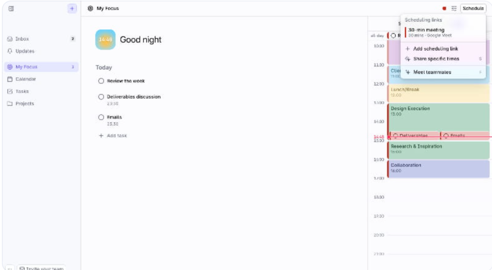
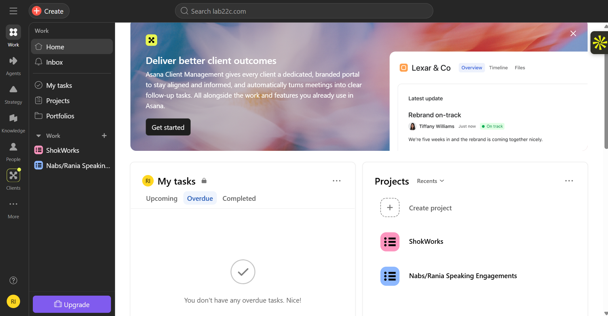
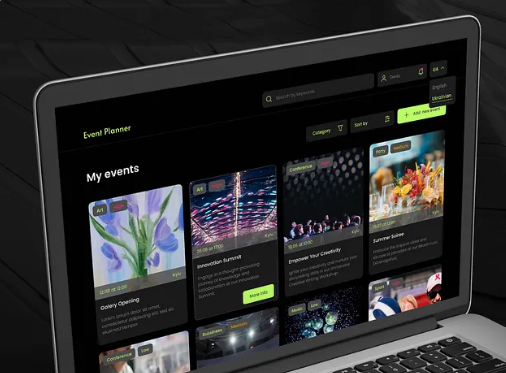

## Design Objectives

UI/UX Inspo 1
- Pre-Agent: One thing I like from this site is the calendar pop-out on the side that shows what's on deck for the day
- Layout: left icon rail (nav), a center "My Focus" column listing today's tasks as plain checkbox rows (no card chrome), and a right-hand day-timeline/calendar rail with color-coded time blocks. Three columns total, open and airy with lots of whitespace — not crowded
- Task rows are minimal: a circle checkbox, task name, and an optional time/subtext underneath. This is close to how a task list under an event should feel

Asana: 
- Pre-Agent: Asana has a clean workspace where you can distinctly see the different projects you're working on in the side bar. It feels clean and organized
- Layout: persistent left sidebar (workspace switcher, Home/Inbox/My tasks/Projects/Portfolios, then a "Work" section listing individual projects by name). Main area is split into a banner/promo zone, then two side-by-side panels below ("My tasks" with Upcoming/Overdue/Completed tabs, and "Projects" as a simple list with a "Create project" affordance)
- Status is shown with small colored dot/badge text ("On track") rather than a progress bar — worth noting since our app needs an actual % progress bar per the proposal
- Dark sidebar + light main content is the contrast pattern; feels organized, not crowded, because each panel has a clear single purpose

UI/UX Inspo 2 
- Pre-Agent I like the card tiles on this site that show each event as being distinct. Different images are helpful and can be replaced with the social media graphics that each event will eventually have
- Layout: dark theme, top search/filter bar, "My events" header, then a card grid (looks like 4 columns) of event tiles. Each tile: cover image, a small category/date tag in the corner, event title, one-line description, and a status/CTA pill ("Book CEO"-style button)
- This is the card-grid pattern we'd use for an events dashboard/list view — each card = one event, image on top, text below, action at the bottom

For this project in particular, the colors can be some combination of a light green and white with gold accents since this is primarily for the Babson MSA.

### Patterns to carry into this app
- **Navigation**: a persistent left sidebar listing events (like Asana's project list), rather than re-navigating from a homepage each time
- **Event list view**: card grid (Inspo 2 style) where each card shows the event name, a progress bar (not just a status dot), and task/budget summary at a glance
- **Event detail view**: plain checkbox-style task rows (Inspo 1 style) grouped under the event, each row showing owner + deadline, with the progress bar recalculated from checked/unchecked state
- **Budget view**: keep it simple and table/list-like rather than card-based, since budgets are numeric totals (per-event and per-semester, split by SGA/OBI) rather than distinct visual items
- Overall density target: closer to Inspo 1's open/airy spacing than a cluttered dashboard — few items per screen, generous whitespace, one clear focal action per panel