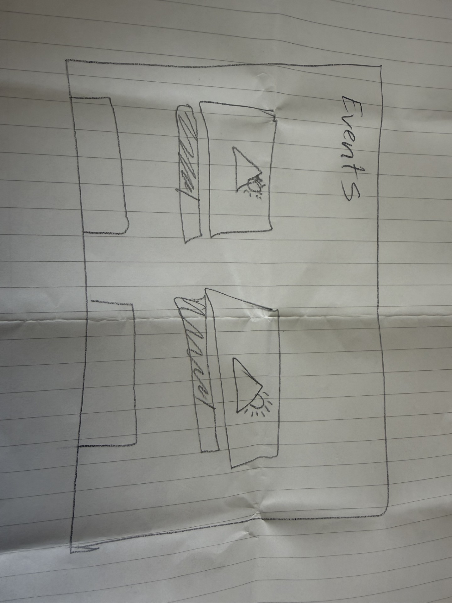
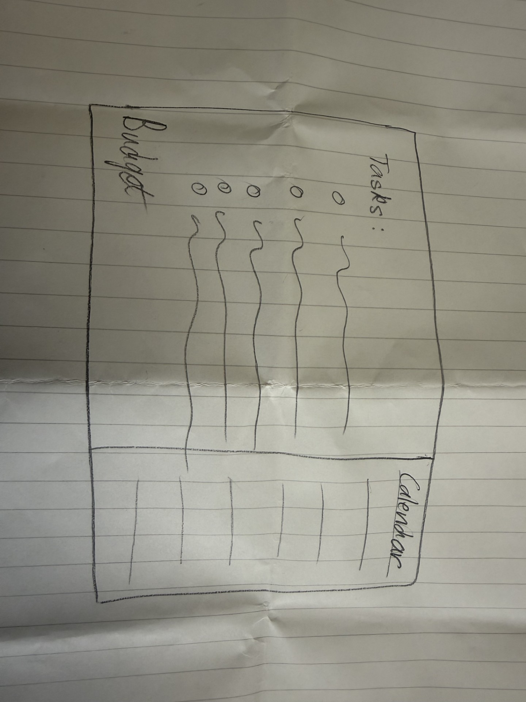

## Proposal for Task Delegator

What I am building: I am building a tool that tracks tasks, budgets, and action items needed for planning on-campus club events

Who it is for: I'm building this for myself and anyone else who holds a campus leadership position that needs a better system to stay organized

What it remembers: The tool should keep track of all the action items that precede an event to make it possible, as well as the budget needs attached to them. Potentially, it can include a section for event details but should primarily focus on showing the necessary tasks, deadlines, and ownership of each 

Where the data lives: The data will live in localStorage for now since I'm the only one who will be using the tool at the moment

What each action changes: Every time a user adds a task, the task count for the respective event should go up. When it gets marked as completed, then the task bar will show that the event is X% of the way to completion. Removing/deleting a task also affects how much work is left. Adding budgets and amounts spent should factor into a total $ spent for the semester, tracking from either the SGA or the OBI budgets.

Features: 
- Mark tasks complete & update progress bar
- See semester totals spent from each budget
- Log bugdet amount per event, attached to SGA or OBI specifically

What I do not know yet: I expect I'll have to figure out how the task bar will look/work. I also believe I'll need to see how the totals work as well as where tasks go once they're marked as completed

My Sketches:

